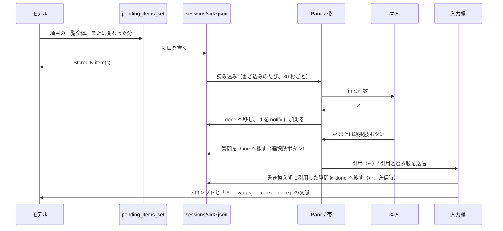

# follow-ups

[English](README.md) · [Privacy（プライバシー）](PRIVACY.md)

Claude Code のプラグインである。Claude は、各セッションが本人に待っていること（質問、本人の作業、
未検証の点、次の手順）を `pending_items_set` ツールで報告する。プラグインはそれを各セッションの
未マージの PR とあわせて、全セッション分、Pane とプロンプト上の1行の帯に表示する。

版は 0.1.5 である。

## インストール

ターミナルの Claude Code で次を実行する。

```
/plugin install follow-ups --marketplace hota911/follow-ups
```

マーケットプレイス（`github:hota911/follow-ups`）の追加を尋ねられたら `y` で答え、スコープを
選ぶ。このコマンドはターミナル専用であり、Claude Desktop アプリの Code タブでは使えない。
ターミナルからユーザースコープでインストールしたプラグインは、ローカルの Desktop セッションでも
読み込まれる。

0.1.2 より前は、リポジトリ名もマーケットプレイス名も `claude-follow-ups` だった。
`follow-ups@claude-follow-ups` をインストールしている場合は、それをアンインストールし、その
マーケットプレイスを削除してから、上のコマンドでインストールし直す。セッションファイルはそのまま残る。

## 使い方

### ツール

プラグインはツール `pending_items_set`（正式名 `mcp__follow-ups__pending_items_set`）を登録し、
いつ呼ぶかを Claude に伝える短い節をシステムプロンプトに加える。呼び出しは `items` と
`changes` のどちらか一方だけを送る。

- `items`: 一覧全体。保存済みの一覧を置き換える。各項目は `id`、`kind`、`text` と、任意の
  `owner`、`url`、`options` を持つ。`items` には `title` が必須である。
- `changes`: 変わった分だけ。`upsert` の項目は同じ id の保存済み項目を置き換え、なければ末尾に
  加える。`remove` の id は一覧から除く（保存されていない id は拒否せず、結果で示す）。
  `title` と `activity` を省くと保存済みの値を保つ。
- `title`: セッションがしていることの短い名前。
- `activity`: セッションがいましていることの1行。Running の横に表示する。`items` では省くと
  消え、`changes` では `""` を送ると消える。

結果の最後の行は、保存済みの id と種類である（例: `Current: q1 (question), merge (next_step).`）。
二つの入力を持つ理由は [docs/design/diff-updates.md](docs/design/diff-updates.md) に書いた。

上限を超えた呼び出しは、切り詰めずに理由を添えて拒否する。上限は、項目 50 個（`items`、`upsert`、
`remove`、`changes` を適用したあとの一覧のそれぞれ）、`id` 64 文字、
`text` 500 文字、`title` 120 文字、`owner` 60 文字、`activity` 120 文字、`url` 2000 文字である。
`url` は `https:` か `http:` の URL に限る（`file:` などほかのスキームは拒否する）。文字列からは制御文字と端末のエスケープシーケンスを取り除く
（改行とタブは残す）。

項目の種類は次のとおりである。

| 種類 | 意味 |
| --- | --- |
| `question` | 本人が答える必要があり、いま答えられること |
| `user_action` | 本人がいますぐできること |
| `unverified` | 検証していない点、または作業の制限 |
| `next_step` | このターンのあとに残る手順。`owner` で誰がするかを示す |

`question` には `options` を付けられる。2〜4個の互いに異なる1行の回答で、各40文字以内である。
ツールを呼べるのはメインのセッションだけであり、サブエージェントからの呼び出しは拒否する。

### Pane

`/follow-ups` で Pane を開く。このセッションの一覧が空から空でなくなったとき、または項目を持つ
セッションを再開したときの開始時にも、自動で開く。一度開いたあと、または本人が閉じたあとは、
一覧が再び空になるまで自動では開かない。

- ビュー: This session（どのセッションもこれで始まる）、By session（セッションごとに1つの枠）、
  By kind（全セッションの項目を Questions for you、Your actions、Open PRs、Next steps、
  Unverified / limits に分ける）。
- 各セッションの見出しに状態を表示する。Running、Background task running（メインループが回答した
  あとも、それが起動したサブエージェントが動いている）、Needs permission、Waiting for you、
  Interrupted、Error、Ended のいずれかである。Ended 以外で 24 時間より古い状態は `stale?` と表示する。
  クラッシュしたセッションは Ended を記録しないためである。Running と Background task running の
  あいだは、状態のあとに `activity` の行を表示する。
- Refresh は再読み込みし、全セッションの PR を確認し直す。`☐ Show done (N)` / `☑ Show done (N)` は
  完了した項目の表示を切り替える。

行のボタンは次のとおりである。

| ボタン | 動作 |
| --- | --- |
| ✓ | 項目または PR を完了にする。完了した項目は 7 日間残り、Show done で表示できる |
| ↺ | ✓ を取り消す（完了した行に出る） |
| ⧉ | 項目の最初のバッククォートのコード部分を、なければ全文をクリップボードにコピーし、`Copied` と表示する |
| ↩ | 種類を先頭に付けた引用（`> Question: ...`）を、下書きを残したまま、このセッションの入力欄に入れる。質問の引用を書き換えずに送ると、その質問を完了にする（選択肢ボタンと同じく、Show done と ↺ で戻せる）。ほかの種類は一覧に残る |
| 選択肢ボタン | このセッションの `options` 付きの質問に出る。質問を完了にし（✓ と同じく、Show done と ↺ で戻せる）、引用した質問と選んだ選択肢を本人のプロンプトとして送る（ターンの実行中ならその後）。ボタンは質問とともに消えるため、もう一度押して回答を重ねて送ることはない。送信に失敗したら質問を元に戻す |
| ↗ | 別のセッションを Claude Desktop アプリで開く（`claude://claude.ai/epitaxy/<id>`）。By session ではセッションの見出しに、By kind では各行に出る |
| Resume | CLI から始めた別のセッション（Desktop の id がない）に出る。`/resume <sessionId>` を入力欄に入れ、送るのは本人である。入力欄に下書きがあるときは拒否する |

### 帯

プロンプトの上の1行で、5種類の件数を 0 も含めて決まった順に並べる:
`Questions 0 · Your actions 1 · PRs 0 · Next 0 · Unverified 0`。既定ではこのセッションの件数を数え、
All sessions / This session で範囲を切り替える。このセッションに何もなく、ほかのセッションにある
ときは `This session: nothing pending · Others N` と表示する。Open は Pane を開き、閉じるボタン
（ターミナルでは ×、Desktop では Close）は、新しい質問か本人の作業が現れるか `/follow-ups` を
実行するまで帯を隠す。件数がすべて 0 のときと、アンケートの表示中は描かない。

### 未マージの PR

PR は Claude が報告するのではなく、プラグインが追跡する。セッションの PR は、作業ディレクトリの
ブランチの PR（開始時と各ターンのあとに `gh pr view`）と、`gh pr create` を実行した Bash コマンドが
出力した PR の URL（`gh pr view <url>` で確認）である。各ターンのあとにセッションの PR を確認し直し、
マージ済みまたはクローズ済みの PR を外す。

## 仕組み

各セッションは JSON ファイルを1つ持つ（`~/.claude/follow-ups/sessions/<sessionId>.json`）。どの
セッションも全ファイルを読むため、どの Pane にも全セッションが出る。以下を行うフックは
`hooks/register.tsx` にあり、フックが呼ぶ処理のうちエンジンを呼ばないものはほかのモジュールにある
（開発の節を参照）。

ファイルを読むのは、ツールの入力と同じ確認を通り、`sessionId` がファイル名と一致し、保存した PR の
URL が github.com のプルリクエストであるときだけである。通らないファイルは上書きしない。読み込みでは
飛ばして Pane にファイル名と理由を表示し、このセッション自身のファイルが通らないときはツールが一覧の
保存を拒否する。直すには、そのファイルを修正するか消す。

| いつ | 何をするか | ファイル | モデルに見えるもの |
| --- | --- | --- | --- |
| セッション開始（`session.start`） | `/follow-ups` とツールを登録する。状態を idle として記録し、全セッションファイルを読み込み、ブランチの PR を調べ、保存済みの PR を確認し直す。再読み込みのタイマーを始める | `sessions/*.json` を読む。自分のファイルに書く（新規作成は PR が見つかったときだけ） | ツールの説明とスキーマ |
| 30 秒ごと | 全セッションファイルを読み込み直し、アーカイブ済みセッションの掃除（下記）を行う。書き込みのたび、ビューの切り替え、Refresh のあとにも読み込み直す | `sessions/*.json` を読む | なし |
| プロンプトの組み立て（`prompt.compose`） | 固定文のシステムプロンプトの節を加える。いつツールを呼ぶか、種類、セッションの言語で書くことである。項目を含まないため、ターンごとに変わらない。チームメイトには加えない | なし | その節（毎ターン） |
| プロンプトの送信（`prompt.submit`） | ファイルの `notify` にある id を取り出して空にする。プロンプトが ↩ の引用を書き換えずに独立した行として含むこのセッションの質問を、`notify` に加えずに `done` へ移す。これはバックグラウンドの処理として行うため、プロンプトはその完了を待たず、失敗は Pane に出る | 自分のファイルを読み書きする | プロンプトの横の文脈。指示の1行のあとに、項目をデータとして `<done-items>` ブロックに入れる。例: `<item id="q1">What is the budget?</item>`（エスケープし、1行にまとめ、200 文字で切る）。トランスクリプトには出ない |
| ターン開始（`turn.start`） | 状態を Running にし、前のターンの `activity` を消す | 自分のファイル | なし |
| モデルが `pending_items_set` を呼ぶ | タイトル、項目、activity を置き換える（`items`）か、`changes` を適用する。本人が完了にした id は落とす。このセッションの一覧が空だったら Pane を開く | 自分のファイルに書く（なければ作る） | `Stored N item(s) for "<title>".` と、隠したままの id と保存されていなかった削除対象の id（あれば）。続けて `Current: <id> (<kind>), ...` |
| Bash の `gh pr create` | 出力にある PR の URL を調べて `prs` に加える。Bash の結果は変えない | 自分のファイル | なし |
| メインループの権限の通知（`classic.Notification` の `permission_prompt`） | 状態を Needs permission にし、その呼び出しが終わったら Running に戻す | 自分のファイル | なし |
| ターン終了（`turn.complete`） | 状態を Waiting for you、Interrupted、Error、または起動したサブエージェントが動いていれば Background task running にする。続いてブランチの PR を調べ、PR を確認し直す。そのサブエージェントの最後の1つが終わると Waiting for you にする | 自分のファイル | なし |
| セッション終了（`session.end`） | 状態を Ended にする | 自分のファイル | なし |
| ✓ / ↺ | 項目を `items` と `done` のあいだで移す（id は `dismissed` に入る）。PR ではなく項目への ✓ は、id を `notify` にも加える | 項目を持つセッションのファイル（別のセッションのこともある） | そのセッションのモデルが、次のプロンプト送信時に受け取る |
| ↩ | 入力欄を読み、下書きと引用で入れ直す。質問の引用を書き換えずに送ると、その質問を `done` へ移す（プロンプトの送信を参照） | 引用を送ったとき、自分のファイル | 本人が送ったものだけ |
| 選択肢ボタン | ✓ と同じく質問を `done` へ移すが、id は `notify` に加えない。続いて引用した質問と選択肢を本人のプロンプトとして送る。送信に失敗したら元に戻す | 自分のファイル | そのプロンプト |
| ⧉ | クリップボードにコピーする | なし | なし |
| ↗ / Resume | `open claude://claude.ai/epitaxy/<hostSessionId>` を実行する / `/resume <sessionId>` を入力欄に入れる | なし | なし |
| アーカイブ済みセッションの掃除（読み込みのたび） | Desktop の id を持つ別のセッションのファイルについて、Desktop アプリの記録を読み、`isArchived: true` ならそのセッションファイルを読み直し、まだ同じ Desktop のセッションを指していれば `rm -f` で消す。自分のファイルは消さない | `~/Library/Application Support/Claude/claude-code-sessions/<account>/<org>/<hostSessionId>.json` を読む。`sessions/<id>.json` を消す | なし |

Show done の切り替えと帯を閉じた状態は、プラグインのストア（`$.store`）に保存する。



## 既知の制限

- セッションファイルは後から書いたほうが勝つ。2つのセッションが同じファイルを同時に書くと
  （そのセッションが一覧を更新しているあいだに ✓ を押すなど）、片方の書き込みが失われることがある。
- Needs permission は、メインループの呼び出しが権限の確認を待っているという通知（`Notification` フック
  イベントの `permission_prompt`）から記録する。Running に戻るのは、
  許可されたときではなく、その呼び出しが終わったときである。
- `gh pr create` から PR を記録できるのは、URL がコマンドの出力にあるときだけである。バックグラウンドで
  実行したコマンドや、出力をリダイレクトしたコマンドからは記録しない。作業ディレクトリのブランチの
  PR は、ブランチの照会で見つかる。
- 追跡するのは github.com の PR だけである。`gh` が別のホスト（GitHub Enterprise）の PR を返すと、
  PR の確認の失敗として表示する。
- ↗ は CLI のプロセスから macOS の `open` を実行するため、それが使えない環境では動かない。
- Desktop では、フォーカスのない Pane への最初のクリックはフォーカスするだけで、次のクリックで
  押せる。フォーカスを得たあとは、押してもフォーカスを保つ。上端の行に `● Focused` または
  `Click to focus`（ターミナルでは `Click or ctrl+x tab to focus`）と表示する。
- Desktop では Pane の文字を選択できないため、項目の文字を取り出すには ⧉ を使う。コピーするのは
  コード部分1つまでである。

## 読み書き、実行、送信するもの

- **外部に送るデータ**: PR を追跡するため、`gh` CLI を通じて GitHub にだけ送る。送るのは
  `gh pr create` が出力した PR か保存済みの PR の URL、またはブランチの PR を調べるときの
  作業ディレクトリのリポジトリとブランチだけである。項目の本文、プロンプト、その他の会話の内容を
  自分でどこかへ送ることはない。プロンプトに加えるもの（仕組みを参照）は、会話のほかの部分と一緒に
  モデルに届く。
- **実行するプログラム**（いずれもコマンドは固定で、5 秒または 30 秒で打ち切る）:
  - `git rev-parse --abbrev-ref HEAD`（セッションの作業ディレクトリで、ブランチ名を得る）
  - `gh pr view --json <fields> [-- <url>]`（ブランチの PR や保存済みの PR を調べる）
  - `rm -f -- <path>`（Desktop のセッションがアーカイブされた、`~/.claude/follow-ups/sessions/`
    の下のセッションファイル1つを消す。`$.fs` に削除がないため）
  - `open claude://claude.ai/epitaxy/<hostSessionId>`（↗ を押したとき、Desktop アプリをその
    セッションに切り替える。macOS のみ）
- **書くファイル**: `~/.claude/follow-ups/sessions/<sessionId>.json` だけである。中身は JSON の
  データである（仕組みを参照）。設定、指示、フックなど、ツールが実行したり従ったりするファイルは書かない。
- **送信するプロンプト**: 質問の選択肢を押したとき、その質問の ↩ の引用に押した選択肢を続けた
  テキストを、本人として送信する。それ以外は送信せず、押さなければ何も送信しない。
- **ツール**: 自前のツール `mcp__follow-ups__pending_items_set` を登録し、それに答える。ほかの
  ツールの代わりには答えない。Bash などの `tool.call` フックは、呼び出しも結果もそのまま渡す。
- **コマンドとシステムプロンプト**: `/follow-ups` コマンド（Pane を開く）と、固定のシステム
  プロンプトの節を1つ加える（仕組みを参照）。それ以外の設定、指示、フック、ツールの説明は変えない。
- **権限ダイアログ**: 権限のフックは持たず、何も判断しない。メインループの呼び出しの
  `permission_prompt` 通知から Needs permission を記録する。

## 依存

- Claude Code の function hooks のプラグイン API（`hooks/hooks.json` が `hooks/register.tsx` を読み込む）。
- アーカイブ済みセッションの掃除に使う Claude Desktop アプリのセッション記録:
  `~/Library/Application Support/Claude/claude-code-sessions/<account>/<org>/<hostSessionId>.json` の
  `isArchived`。これはアプリ独自の非公開の形式である。記録がない、解析できない、`isArchived: true` が
  ない、のいずれかならファイルを残すため、形式が変わっても掃除が止まるだけである。
- PR の追跡に使う `gh` CLI。照会に失敗すると、エラーの最初の行を Pane に表示する。
- Desktop のセッション id は環境変数 `CLAUDE_CODE_HOST_SESSION_ID` から得る。

## 開発

プラグインが読み書き、実行、送信するものや、フックするイベントを変える前に [AGENTS.md](AGENTS.md)
を読む。変更は PRIVACY.md、この README、ディレクトリへの申請内容と矛盾してはならない。

エンジンは `$` を同じファイルで宣言した関数の中までしか追わない。このため、`$` を呼ぶ関数と
フックはすべて `hooks/register.tsx` に置き、ほかのモジュールには `$` を呼ばない処理だけを置く。

| ファイル | 役割 |
| --- | --- |
| `hooks/register.tsx` | フック、状態の atom、`$` を呼ぶすべての関数 |
| `hooks/render.tsx` | Pane と帯の描画 |
| `hooks/rows.ts` | 行のモデル（並び順、グループ、✓ 後のフォーカス先、帯が記録する id） |
| `hooks/items.ts` | ツール、✓、↺、選択肢ボタン、完了の通知がセッションファイルをどう変えるか |
| `hooks/prs.ts` | `gh pr create` が出力した PR の URL、`gh pr view` の引数と結果の解釈、保存した PR の解析、PR の確認結果の反映 |
| `hooks/state.ts` | ターンの終わり方と状態の対応 |
| `hooks/store.ts` | セッションファイルの場所、読み書きを直列にするキュー |
| `hooks/actions.ts` | ↩、選択肢ボタン、⧉、↗ が作るものと、送ったプロンプトがどの質問への返信か |
| `hooks/common.ts` | プラグイン、Pane、ツールの名前と、モジュール共通の文字列処理 |
| `hooks/parse.ts` | ツールの入力、セッションファイル、Desktop の記録の検査と、完了の記録の期限切れ |
| `hooks/schema.ts` | ツールの入力スキーマ |
| `hooks/prompts.ts` | モデルが読むすべての文言 |

設計メモは `docs/design/` にある: [差分での更新](docs/design/diff-updates.md)。

テストは `tests/` に振る舞いごとのファイルで置く。`tool`（入力の検査と呼び出しが保存する内容）、
`session-files`（解析できないファイル、アーカイブされた Desktop セッション）、`done`（✓、↺、
Show done、✓ 後のフォーカス）、`done-notice`、`buttons`（↩、選択肢、↗、Resume、送った ↩ の引用、⧉）、
`pane`（自動で開く条件、表示）、`band`、`state`、`prs` である。共通の準備は `tests/world.ts` に置く。
リポジトリのルートで次を実行する。

```
claude plugin test .
claude plugin validate .
```

`claude plugin validate .` は、マーケットプレイスのファイル、プラグインのマニフェスト、フックを検証する。
どちらもプルリクエストごとに実行される（`.github/workflows/ci.yml`）。使う Claude Code のバージョンはそのファイルで固定している。

型チェックは手元で行い、CI では行わない。`claude-code` の型定義はパッケージとして公開されておらず、
Claude Code が読み込んだ mod の `.claude-plugin/types/` に `tsconfig.json` とともに書き出す。
下の `scripts/dev-copy.sh` を実行し、セッションにコピーを読み込ませてから、次を実行する。

```
scripts/typecheck.sh           # セッション ID は $CLAUDE_CODE_SESSION_ID から取る
```

コピーの `hooks/` と `types/` に対して `tsc`（TypeScript は `npx` で取得する）を実行する。

### 開発用コピーで試す

変更したコピーをインストール済みの版と並べて動かすには、読み込ませたい Claude Code のセッションの中で、
チェックアウト（どのワークツリー、ブランチでもよい）から次を実行する。

```
scripts/dev-copy.sh            # セッション ID は $CLAUDE_CODE_SESSION_ID から取る
scripts/dev-copy.sh <session>  # セッションを指定する場合
```

このスクリプトは、作業ツリーの `.claude-plugin/plugin.json`、`hooks/`、`types/` を、未コミットの変更も
含めて、そのセッションの dev-mods フォルダ `~/.claude/dev-mods/<session>/follow-ups-dev/` に前回の
コピーと置き換えてコピーする（`FOLLOW_UPS_DEV_MODS` で `~/.claude/dev-mods` を変えられる）。そのうえで
コピーの名前を `follow-ups-dev` に変え、古い名前が残っていないことを確かめ、`claude plugin validate` で
検証し、コピーのパスを出力する。名前を変えないと、インストール済みの版が Pane を描く。スクリプトは
次の箇所の `follow-ups` を `follow-ups-dev` に置き換える。

- `.claude-plugin/plugin.json` の `name`（フォルダ名と一致させる）。
- `hooks/common.ts` の `PLUGIN` と `PANE`（`PANE_TITLE` は `Follow-ups (dev)` にする）。
- `hooks/register.tsx` の atom の `plugin`、コマンド名、Pane の matcher の `requestId`、ツール名
  `mcp__follow-ups__pending_items_set` を含む matcher。
- `types/index.d.ts` のモジュール拡張のキー。

セッションファイルの場所は変えない。コピーが同じファイルを読み書きするためである。ソースが変わって
これらの箇所のどれかが一致しなくなった場合、スクリプトはその箇所を示して止まる。そのときはソースに
合わせてスクリプトを直す。

## ライセンス

[MIT](LICENSE)
