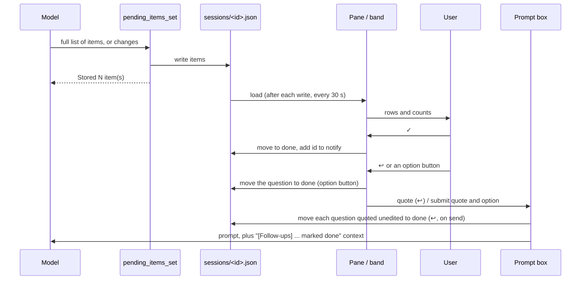

# follow-ups

[日本語](README.ja.md) · [Privacy](PRIVACY.md)

A Claude Code plugin. Claude reports what each session is waiting on you for (questions, your
own actions, unverified points and next steps) through the `pending_items_set` tool. The plugin
shows these, together with each session's open PRs, for all your sessions in a pane and in a
one-line band above the prompt.

Version 0.1.5.

## Install

In Claude Code in a terminal:

```
/plugin install follow-ups --marketplace hota911/follow-ups
```

Answer `y` when asked to add the marketplace (`github:hota911/follow-ups`) and choose a
scope. The command is available in the terminal only; the Code tab of the Claude Desktop app
does not offer it. A plugin installed at user scope from a terminal also loads in local Desktop
sessions.

The repository was named `claude-follow-ups` and its marketplace `claude-follow-ups` before
0.1.2. If you installed `follow-ups@claude-follow-ups`, uninstall it, remove that marketplace,
and install again with the command above; session files are kept.

## Usage

### The tool

The plugin registers the tool `pending_items_set` (full name
`mcp__follow-ups__pending_items_set`) and adds a short section to the system prompt telling
Claude when to call it. Each call sends exactly one of `items` or `changes`:

- `items`: the full list, which replaces the stored one. Each item has `id`, `kind`, `text`,
  and optionally `owner`, `url` and `options`. `title` is required with it.
- `changes`: only what changed. `upsert` holds items that replace the stored item with the same
  id, or are appended; `remove` holds ids to drop (an id not stored is named in the result, not
  refused). An omitted `title` or `activity` keeps the stored one.
- `title`: a short name for what the session is doing.
- `activity`: one line on what the session is doing now, shown next to Running. With `items`,
  omitting it clears the line; with `changes`, `""` clears it.

Every result ends with the stored ids and kinds, e.g. `Current: q1 (question), merge (next_step).`
See [docs/design/diff-updates.md](docs/design/diff-updates.md) for why both inputs exist.

A call over a limit is refused with the reason, never cut: at most 50 items (in `items`, in
`upsert`, in `remove`, and in the list a `changes` call would leave); `id` 64
characters, `text` 500, `title` 120, `owner` 60, `activity` 120, `url` 2000. `url` must be an
`https:` or `http:` URL (other schemes such as `file:` are refused). Control characters and terminal escape sequences are removed from the text
(newlines and tabs are kept).

Item kinds:

| Kind | Meaning |
| --- | --- |
| `question` | Something you must answer and can answer now |
| `user_action` | Something you can do right now |
| `unverified` | A point not verified, or a limitation of the work |
| `next_step` | A remaining step after this turn, with `owner` naming who does it |

A `question` may carry `options`: 2 to 4 distinct one-line answers of at most 40 characters.
Only the main session may call the tool; a call from a subagent is refused.

### The pane

`/follow-ups` opens the pane. It also opens by itself when this session's list goes from empty
to non-empty, or at start for a resumed session that has items. Once it has opened, or once you
close it, it waits until the list is empty again.

- Views: This session (the default every session starts on), By session (one box per session)
  and By kind (all sessions' items grouped as Questions for you, Your actions, Open PRs, Next
  steps, Unverified / limits).
- Each session header shows its state: Running, Background task running (the main loop answered
  while a subagent it started still runs), Needs permission, Waiting for you, Interrupted, Error
  or Ended. A state other than Ended older than 24 hours is shown as `stale?`, since a crashed
  session never records Ended. While Running or Background task running, the `activity` line
  follows the state.
- Refresh reloads and re-checks every session's PRs. `☐ Show done (N)` / `☑ Show done (N)` shows
  or hides done items.

Buttons on a row:

| Button | What it does |
| --- | --- |
| ✓ | Marks the item or PR done. Done items are kept for 7 days and can be shown with Show done |
| ↺ | Undoes ✓ (on a done row) |
| ⧉ | Copies the item's first backtick code span, or its whole text when it has none, and shows `Copied` |
| ↩ | Quotes the item, led by its kind (`> Question: ...`), into this session's prompt box, keeping your draft. Sending a question's quote unedited marks that question done (as an option button does), so Show done and ↺ bring it back; other kinds stay listed |
| Option buttons | On this session's questions with `options`: marks the question done (as ✓, so Show done and ↺ bring it back) and sends the quoted question and the option as your prompt (after the current turn, if one is running). The buttons go with the question, so a second press cannot send the answer again. If the send fails, the question is put back |
| ↗ | Opens another session in the Claude Desktop app (`claude://claude.ai/epitaxy/<id>`). In By session it sits in the session header, in By kind on each row |
| Resume | For another session started from the CLI (no Desktop id): puts `/resume <sessionId>` in the prompt box for you to send. Refused while the box holds a draft |

### The band

One line above the prompt with all five counts in a fixed order, zeros included:
`Questions 0 · Your actions 1 · PRs 0 · Next 0 · Unverified 0`. It counts this session by
default; All sessions / This session switches the scope. When this session has nothing but
others do, it reads `This session: nothing pending · Others N`. Open opens the pane, and the
close control (× in the terminal, Close on the desktop) hides the band until a new question or
user action appears or `/follow-ups` runs. The band is not drawn while every count is 0, nor
while a survey is shown.

### Open PRs

PRs are tracked by the plugin, not reported by Claude. A session's PRs are the PR of its working
directory's branch (`gh pr view`, at start and after each turn) and every PR URL printed by a
Bash command that runs `gh pr create` (looked up with `gh pr view <url>`). After each turn the
session's PRs are checked again; a merged or closed PR is removed.

## How it works

Each session keeps one JSON file, `~/.claude/follow-ups/sessions/<sessionId>.json`. Every
session reads all of them, so each pane shows every session. The hooks that do the following are
in `hooks/register.tsx`; the code they call that does not touch the engine is in the other modules
(see Development).

A file is read only when it passes the same checks as the tool's input, its `sessionId` equals
its file name, and its stored PR URLs are github.com pull requests. A file that fails is never
overwritten: loads skip it and the pane names it with the reason, and the tool refuses to store
a list over this session's own such file. Fix or remove the file to recover.

| When | What happens | Files | What the model sees |
| --- | --- | --- | --- |
| Session start (`session.start`) | Registers `/follow-ups` and the tool. Records the state as idle, loads all session files, looks up the branch PR and re-checks the stored PRs. Starts the reload timer | Reads `sessions/*.json`; writes its own file (created only when a PR is found) | The tool's description and schema |
| Every 30 seconds | Reloads all session files and runs the archived-session cleanup (below). A reload also follows every write, a view switch and Refresh | Reads `sessions/*.json` | Nothing |
| Prompt compose (`prompt.compose`) | Adds a fixed system prompt section: when to call the tool, the kinds, and to write in the session's language. It holds no items, so it does not change between turns. Skipped for teammates | None | The section, every turn |
| Prompt submit (`prompt.submit`) | Takes the ids in the file's `notify` list and clears it. Moves each of this session's questions whose ↩ quote the prompt holds unedited, on lines of its own, to `done` without adding it to `notify`; this runs as a background step, so the prompt never waits on it and a failure shows in the pane | Reads and writes its own file | Context beside the prompt: one instruction line, then the items as data in a `<done-items>` block, e.g. `<item id="q1">What is the budget?</item>` (escaped, on one line, cut at 200 characters). It is not shown in the transcript |
| Turn start (`turn.start`) | State Running; the previous turn's `activity` is removed | Its own file | Nothing |
| The model calls `pending_items_set` | Replaces the title, items and activity (`items`), or applies `changes` to them. Ids you already marked done are dropped. The pane opens if this session's list was empty | Writes its own file (creating it) | `Stored N item(s) for "<title>".`, plus the ids kept hidden and the removed ids not stored, if any; then `Current: <id> (<kind>), ...` |
| Bash `gh pr create` | PR URLs in its output are looked up and added to `prs`. The Bash result is unchanged | Its own file | Nothing |
| Permission notification in the main loop (`classic.Notification`, `permission_prompt`) | State Needs permission; back to Running when that call finishes | Its own file | Nothing |
| Turn end (`turn.complete`) | State Waiting for you, Interrupted, Error, or Background task running while a subagent it started is active. Then the branch PR lookup and the PR re-check. When the last such subagent ends, Waiting for you | Its own file | Nothing |
| Session end (`session.end`) | State Ended | Its own file | Nothing |
| ✓ / ↺ | Moves the item between `items` and `done` (with its id in `dismissed`). ✓ on an item, not a PR, also adds its id to `notify` | The owning session's file, which may be another session's | That session's model, at its next prompt submit |
| ↩ | Reads the prompt box and refills it with the draft and the quote. Sending a question's quote unedited moves the question to `done` (see Prompt submit) | Its own file, when the quote is sent | Only what you send |
| Option button | Moves the question to `done` as ✓ does, but does not add its id to `notify`, then submits the quoted question and the option as your prompt. A failed submit moves it back | Its own file | That prompt |
| ⧉ | Copies to the clipboard | None | Nothing |
| ↗ / Resume | Runs `open claude://claude.ai/epitaxy/<hostSessionId>` / fills `/resume <sessionId>` | None | Nothing |
| Archived-session cleanup (on every load) | For another session's file that has a Desktop id, reads the Desktop app's record; if it says `isArchived: true`, reads the session file again and, if it still names that Desktop session, deletes it with `rm -f`. Its own file is never deleted | Reads `~/Library/Application Support/Claude/claude-code-sessions/<account>/<org>/<hostSessionId>.json`; deletes `sessions/<id>.json` | Nothing |

The Show done toggle and the band's closed state are kept in the plugin's store (`$.store`).



## Known limitations

- Session files are last-write-wins: two sessions writing the same file at once (a ✓ pressed
  while that session updates its list) can drop one write.
- Needs permission is recorded from the notification that a main-loop call waits for permission
  (`Notification` hook event, `permission_prompt`). It returns to Running when
  the asked call finishes, not when it is approved.
- A PR is recorded from `gh pr create` only when its URL is in the command's output. A command
  run in the background, or one whose output is redirected, records nothing; the branch lookup
  still finds the PR of the working directory's own branch.
- Only github.com PRs are tracked. A PR `gh` reports on another host (GitHub Enterprise) shows as
  a failed PR check instead.
- ↗ runs macOS's `open` through the CLI process, so it does not work where that is not
  available.
- On the desktop, the first click on an unfocused pane only focuses it; the next click presses.
  Once focused, the pane keeps focus across presses. The line at the top shows `● Focused`, or
  `Click to focus` (`Click or ctrl+x tab to focus` in the terminal).
- Text in the pane cannot be selected on the desktop, so ⧉ is the way to take an item's text
  out. It copies one code span at most.

## What it reads, writes, runs and sends

- **Data it sends out**: only to GitHub, through the `gh` CLI, for PR tracking. It sends the
  URL of a PR printed by `gh pr create` or already stored, or nothing but the working directory's
  repository and branch when it looks up the branch's PR. It sends no item text, prompt or other
  conversation content anywhere itself; what it adds to the prompt (see How it works) reaches the
  model with the rest of the conversation.
- **Programs it runs**, each with a fixed command and a 5- or 30-second limit:
  - `git rev-parse --abbrev-ref HEAD` in the session's working directory, to name the branch.
  - `gh pr view --json <fields> [-- <url>]`, to look up the branch's PR or a stored PR.
  - `rm -f -- <path>` on one session file under `~/.claude/follow-ups/sessions/` whose Desktop
    session is archived (`$.fs` has no delete).
  - `open claude://claude.ai/epitaxy/<hostSessionId>` when you press ↗, to switch the Desktop
    app to that session (macOS only).
- **Files it writes**: only `~/.claude/follow-ups/sessions/<sessionId>.json`, plain JSON data
  (see How it works). No settings, instructions, hooks or other files that tools run or obey.
- **Prompts it submits**: when you press an option of a question, it submits, as you, the
  question's ↩ quote followed by the option you pressed. It submits nothing else, and nothing
  without a press.
- **Tools**: it registers its own tool, `mcp__follow-ups__pending_items_set`, and answers it. It
  does not stand in for any other tool; the Bash and other `tool.call` hooks pass each call and
  its result on unchanged.
- **Commands and system prompt**: it adds the `/follow-ups` command (opens the pane) and one fixed
  system prompt section (see How it works). It changes no other settings, instructions, hooks or
  tool descriptions.
- **Permission dialogs**: the plugin has no permission hook and decides nothing. It records Needs
  permission from the `permission_prompt` notification of a main-loop call.

## Dependencies

- The function hooks plugin API of Claude Code (`hooks/hooks.json` loads `hooks/register.tsx`).
- The Claude Desktop app's session records, for the archived-session cleanup:
  `isArchived` in `~/Library/Application Support/Claude/claude-code-sessions/<account>/<org>/<hostSessionId>.json`.
  This is the app's own, non-public format. A missing record, one that does not parse, or one
  without `isArchived: true` keeps the file, so a format change only stops the cleanup.
- The `gh` CLI, for PR tracking. A failed lookup shows its first error line in the pane.
- The Desktop session id comes from the `CLAUDE_CODE_HOST_SESSION_ID` environment variable.

## Development

Before changing what the plugin reads, writes, runs, sends or hooks, read [AGENTS.md](AGENTS.md):
the change must stay consistent with PRIVACY.md, this README and the directory submission.

The engine follows `$` only into functions declared in the same file. So every function and hook
that calls `$` lives in `hooks/register.tsx`, and the other modules hold only code that does not.

| File | Role |
| --- | --- |
| `hooks/register.tsx` | Hooks, state atoms, and every function that calls `$` |
| `hooks/render.tsx` | Drawing the pane and the band |
| `hooks/rows.ts` | The row model: order, groups, focus after ✓, the ids the band records |
| `hooks/items.ts` | How the tool, ✓, ↺, option buttons and the done notice change a session file |
| `hooks/prs.ts` | The PR urls `gh pr create` printed, `gh pr view` arguments and result, stored PRs, applying PR checks |
| `hooks/state.ts` | Which state each end of a turn leaves |
| `hooks/store.ts` | Session file locations and the queue that serializes reads and writes |
| `hooks/actions.ts` | What ↩, option buttons, ⧉ and ↗ produce, and which questions a sent prompt replies to |
| `hooks/common.ts` | Plugin, pane and tool names, and the text helpers the modules share |
| `hooks/parse.ts` | Checking tool input, session files and Desktop records, and the expiry of done entries |
| `hooks/schema.ts` | The tool's input schema |
| `hooks/prompts.ts` | Every text the model reads |

Design notes are in `docs/design/`: [diff updates](docs/design/diff-updates.md).

Tests are in `tests/`, one file per behaviour: `tool` (input checks and what a call stores),
`session-files` (files that do not parse, archived Desktop sessions), `done` (✓, ↺, Show done,
focus after ✓), `done-notice`, `buttons` (↩, choices, ↗, Resume, a sent ↩ quote, ⧉), `pane`
(automatic open, views), `band`, `state` and `prs`. Shared setup is in `tests/world.ts`.
Run at the repository root:

```
claude plugin test .
claude plugin validate .
```

`claude plugin validate .` checks the marketplace file, the plugin manifest and the hooks.
Both run on every pull request (`.github/workflows/ci.yml`), with the Claude Code version
pinned there.

Type-check locally; CI does not. The `claude-code` types are not published in a package: Claude
Code writes them, with a `tsconfig.json`, into `.claude-plugin/types/` of a mod it has loaded. Run
`scripts/dev-copy.sh` (below), let the session load the copy, then:

```
scripts/typecheck.sh           # session id from $CLAUDE_CODE_SESSION_ID
```

It runs `tsc` (TypeScript from `npx`) on the copy's `hooks/` and `types/`.

### Trying a development copy

To run a modified copy next to the installed version, run this from the checkout (any worktree
or branch) inside the Claude Code session that should load it:

```
scripts/dev-copy.sh            # session id from $CLAUDE_CODE_SESSION_ID
scripts/dev-copy.sh <session>  # or name the session
```

It copies the working tree's `.claude-plugin/plugin.json`, `hooks/` and `types/`, uncommitted
edits included, into the session's dev-mods folder,
`~/.claude/dev-mods/<session>/follow-ups-dev/` (`FOLLOW_UPS_DEV_MODS` overrides
`~/.claude/dev-mods`), replacing the previous copy. It then renames the copy to `follow-ups-dev`,
checks that no old name is left, runs `claude plugin validate` on it and prints its path. Without
the rename, the installed version draws the pane. The script replaces `follow-ups` with
`follow-ups-dev` in:

- `name` in `.claude-plugin/plugin.json` (it must match the folder name).
- `PLUGIN` and `PANE` in `hooks/common.ts` (and set `PANE_TITLE` to `Follow-ups (dev)`).
- In `hooks/register.tsx`: the atoms' `plugin`, the command name, the pane matcher's
  `requestId`, and the matcher with the tool name `mcp__follow-ups__pending_items_set`.
- The module augmentation key in `types/index.d.ts`.

It keeps the session file location, so the copy reads and writes the same files. If the
source changed so that one of these places no longer matches, the script stops and names it;
update the script with the source.

## License

[MIT](LICENSE)
